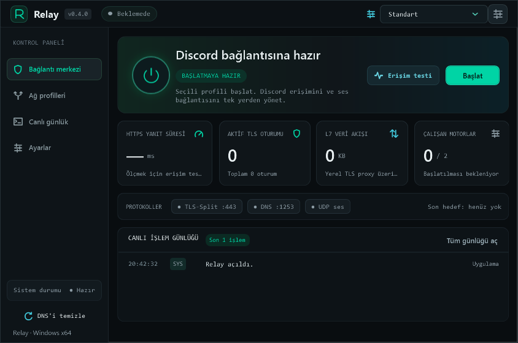
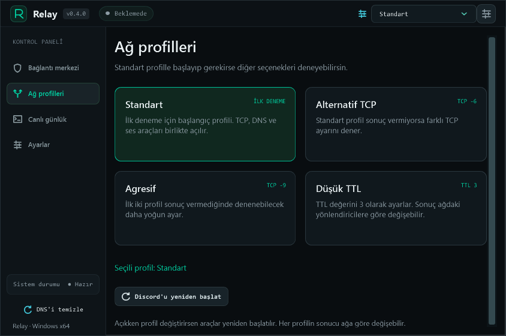
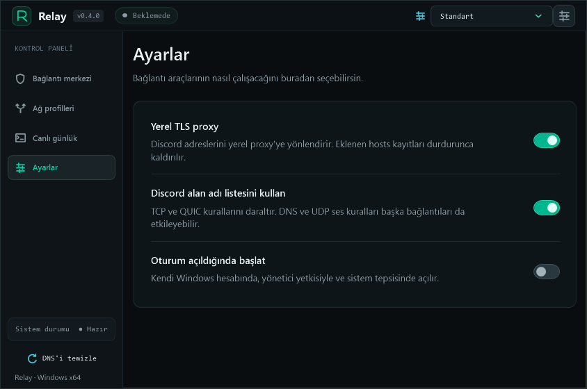
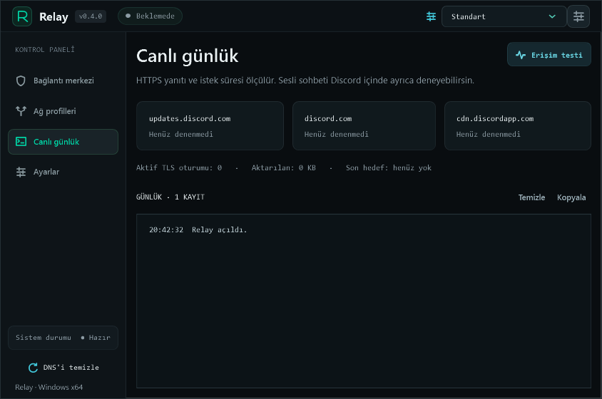

<p align="center">
  
</p>

<h1 align="center">Relay</h1>

<p align="center">
  Windows için Discord bağlantı aracı
</p>

<p align="center">
  <a href="https://github.com/AhmetTrk09/relay-discord/releases/latest"></a>
  
  <a href="LICENSE"></a>
</p>

<p align="center">
  
</p>

Relay; GoodbyeDPI, zapret ve yerel bir TLS proxy'yi tek arayüzden yöneten bir Windows uygulamasıdır. Ağ araçlarını seçilen profile göre başlatır, durdurur ve bağlantı durumunu izler.

## Özellikler

- Dört hazır bağlantı profili, çalışırken tek tıkla profil değişimi
- Yerel TLS proxy ve alan adı listesiyle sınırlandırılmış yönlendirme
- HTTPS erişim testi, canlı işlem günlüğü ve oturum/veri sayaçları
- Sistem tepsisinde çalışma ve isteğe bağlı olarak oturum açılışında başlatma
- Durdurulduğunda yalnızca Relay'in başlattığı süreçleri kapatma ve eklediği hosts kayıtlarını temizleme
- Kurulum (Setup) ve taşınabilir ZIP seçenekleri; ağ araçları paketle birlikte gelir

## İndirme

| Paket | Açıklama |
| --- | --- |
| [**Setup**](https://github.com/AhmetTrk09/relay-discord/releases/latest) | Önerilen. Kurulum yapar ve Başlat menüsüne kısayol ekler. |
| [**Taşınabilir ZIP**](https://github.com/AhmetTrk09/relay-discord/releases/latest) | Kurulum gerektirmez. Arşivin tamamını bir klasöre çıkarıp `Relay.exe` dosyasını çalıştırın. |

**Gereksinimler:** Windows 10 veya 11 (64 bit) ve yönetici izni. Ek bir kurulum gerekmez; uygulamanın kullandığı .NET Framework 4.8 güncel Windows 10 ve 11 sürümlerinde hazır gelir.

## Kullanım

1. Relay'i açın. Uygulama yönetici izni ister ve standart profille başlar.
2. Bağlantı sağlanamazsa üst çubuktan veya **Ağ profilleri** bölümünden farklı bir profil seçin.
3. **Durdur** düğmesi ağ araçlarını kapatır ve hosts kayıtlarını kaldırır.
4. Uygulamadan tamamen çıkmak için sistem tepsisindeki simgeden **Durdur ve çık** seçeneğini kullanın.

Yerel proxy, alan adı listesi ve otomatik başlatma seçenekleri **Ayarlar** bölümündedir. **Erişim testi** yalnızca HTTPS erişimini doğrular; sesli sohbeti Discord içinde ayrıca denemeniz gerekir.

<details>
<summary>Diğer ekran görüntüleri</summary>
<br>



</details>

## Nasıl çalışır?

Relay bir VPN değildir ve ağ bağdaştırıcısının DNS ayarlarını değiştirmez.

- **GoodbyeDPI** DNS sorgularını yönlendirir ve TCP bağlantılarını işler.
- **zapret** UDP ses trafiği ve bazı Discord bağlantıları üzerinde çalışır.
- **Yerel TLS proxy** etkinse belirli Discord alan adları hosts dosyası üzerinden `127.0.0.1` adresine yönlendirilir.

DNS ve UDP kuralları diğer bağlantıları da etkileyebilir ve sonuçlar ağdan ağa farklılık gösterebilir.

## Sorun giderme

- **Discord bağlanmıyor:** Farklı bir profil deneyin. Başka bir GoodbyeDPI veya zapret örneği çalışıyorsa önce onu kapatın.
- **Yerel proxy başlamıyor:** `127.0.0.1:443` başka bir uygulama tarafından kullanılıyor olabilir. **Ayarlar** bölümünden yerel proxy'yi kapatıp yeniden deneyin.
- **Ses yok:** Erişim testi yalnızca HTTPS'i kontrol eder; sesli sohbet UDP kullanır. Farklı bir profil seçip ses kanalına yeniden bağlanın.
- **Zorla kapanmadan sonra Discord'a erişilemiyor:** Relay'i açıp **Durdur**'a basın. Uygulama açılmıyorsa `%SystemRoot%\System32\drivers\etc\hosts` dosyasını yönetici olarak açın, `# [Relay-Start]` ile `# [Relay-End]` arasındaki bloğu silin ve `ipconfig /flushdns` komutunu çalıştırın.

## Kaynaktan derleme

Windows'ta yüklü .NET Framework C# derleyicisi kullanılır; ek bir SDK veya NuGet paketi gerekmez.

```cmd
build.bat
```

Çıktı `artifacts/build/` klasörüne yazılır. Setup ve ZIP paketlerini oluşturmak için:

```powershell
powershell -NoProfile -ExecutionPolicy Bypass -File scripts/package.ps1 -IncludeInstaller
```

Paketler `artifacts/release/` altında oluşturulur. Ağ araçlarının dosyaları paketlemeden önce `third-party/` içindeki SHA-256 özetleriyle doğrulanır. Yeni sürüm için `VERSION` dosyasını güncelleyip `v<sürüm>` etiketini göndermeniz yeterlidir; GitHub Actions Setup ve ZIP'i taslak sürüme ekler.

Hata bildirimleri ve öneriler için [issue](https://github.com/AhmetTrk09/relay-discord/issues) açabilirsiniz.

## Lisans

Relay kaynak kodu [MIT](LICENSE) lisansıyla dağıtılır. Paketlenen üçüncü taraf bileşenler kendi lisanslarına tabidir; ayrıntılar [THIRD_PARTY_NOTICES.md](THIRD_PARTY_NOTICES.md) dosyasındadır.

[GoodbyeDPI](https://github.com/ValdikSS/GoodbyeDPI), [zapret](https://github.com/bol-van/zapret), [WinDivert](https://github.com/basil00/WinDivert) ve [Cygwin](https://cygwin.com/) geliştiricilerine teşekkürler.

> Relay, Discord Inc. ile bağlantılı değildir ve Discord'un resmî bir uygulaması değildir. Uygulama ve Setup dosyaları şu anda kod imzalama sertifikasıyla imzalanmamıştır.
